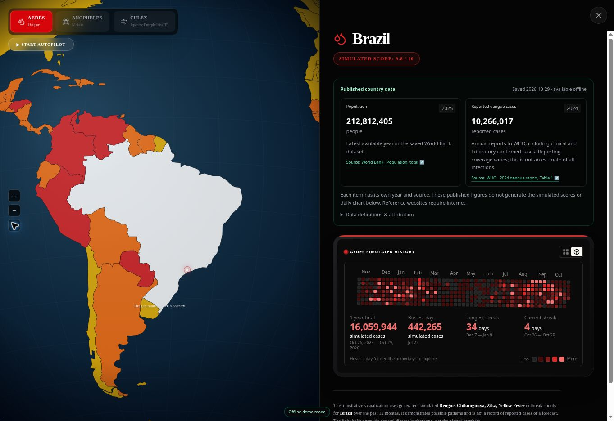

# Competition preparation

1. On the exact device, browser and site address used for the presentation, open the site while online.
2. Wait for **Offline ready** at the bottom. If an update is ready, open the status and choose **Apply update & reload** before the rehearsal.
3. Open the status and choose **Test saved demo**. This reloads the saved version and prevents network fallback for its files. Exit this mode from the same panel.
4. Turn off Wi-Fi (and mobile data, if applicable), reload, open the simulator, choose multiple countries and all three mosquito modes. Visit the homepage and SENT SCENT presentation as well.
5. Keep the browser's site data. Installing the PWA is optional. Each device/browser needs its own first online preparation; an uncached first visit cannot work offline. Browser eviction or manually clearing site data requires preparation again.

The saved release includes all routes, lazy JavaScript, local fonts, maps, images and the country snapshot. Source links point to outside websites and need internet. Source names, values, dates and explanatory notes remain readable offline.

Updates wait for an explicit reload, so a new release does not replace the app during a presentation. A partial download, checksum mismatch or unavailable storage cannot report a new release as ready. Old releases and unrelated browser data are preserved.

Validation on 29 Oct 2026: 60 unit/data tests passed. All 80 deployed resources (12.8 MB) matched their release checksums. On the HTTPS production site, the saved-demo mode loaded `/`, `/simulator` and the previously unvisited `/sent-scent` route, with country data and a Thailand-to-Japan flight working. Browser inspection used the software renderer because hardware WebGL was unavailable. Network loss, cache eviction, incomplete downloads and mixed-release files were also exercised in service-worker tests. Physical Wi-Fi-off rehearsal on the presentation device remains the preparation step above.

If saved files are missing, **Check / retry** downloads the verified release again even when there is no new deployment. It does not clear unrelated data.

## Published data

`src/data/country-evidence.json` is a committed, dated snapshot. Builds and runtime never require a data API. Each observation carries its own year, source ID and official citation URL. The population and disease cards are independent from the illustrative scores and generated daily chart.

- Population: latest non-null World Bank `SP.POP.TOTL` observation, country and territory entries only; regional aggregates excluded. Original providers and CC BY 4.0 attribution are shown in the panel.
- Malaria: latest non-null World Bank `SH.MLR.INCD.P3` observation from WHO. It is an estimated annual incidence per 1,000 people at risk, not a raw case count.
- Dengue: reported cases in the first numeric column of WHO Weekly Epidemiological Record 100(52), Table 1, pages 667–670. These are 2024 reports received by 10 Dec 2025, published 26 Dec 2025. Clinical and confirmed cases are included. The reviewed factual extract is in `data/sources/who-dengue-2024.csv`. Overseas entries are never summed into a parent-country row. The table's ambiguous death-zero entries are not imported.
- JE: concise season facts from CDC Yellow Book 2026, Table 4.7.1, updated 20 Feb 2026. Unknown/no-data entries remain empty. A season is not a patient count or a prediction. Geographic qualifications and incomplete-surveillance notes accompany the data.

All source URLs and publication metadata are in the snapshot. The UI retains missing observations as null/“—”; it does not infer zero or absence of transmission. France's row is explicitly scoped because the source lists overseas areas separately.

Refresh World Bank data manually with `python scripts/import-country-data.py`, or reproduce an import from downloaded API JSON with `--snapshot-dir PATH`. Review the WHO/CDC source files against their cited publications before changing them. Identifier matching is exact, with explicit reviewed aliases; fuzzy geographic matching is not used. Run `npm test` and `npm run build` after refreshing.

## Build and flight behavior

`npm run build` runs Next.js and then `scripts/build-offline.mjs`. The script generates exact HTML snapshots and a service worker containing SHA-256 hashes of every required asset. Generated artifacts are ignored by git and regenerated on deployment. `next dev` deliberately does not install the production worker.

Both renderers share a great-circle route, smooth acceleration/cruise/deceleration and a low climb/descent profile. The plane is substantially smaller (about 32 desktop pixels / 26 mobile pixels in WebGL at the target view). Attitude follows the route tangent with damped orientation, without artificial side-to-side rolling. A country change departs from the previous reached selection; rapid new choices queue the latest next destination. Flight duration remains a visual demonstration, not a real travel-time estimate.
